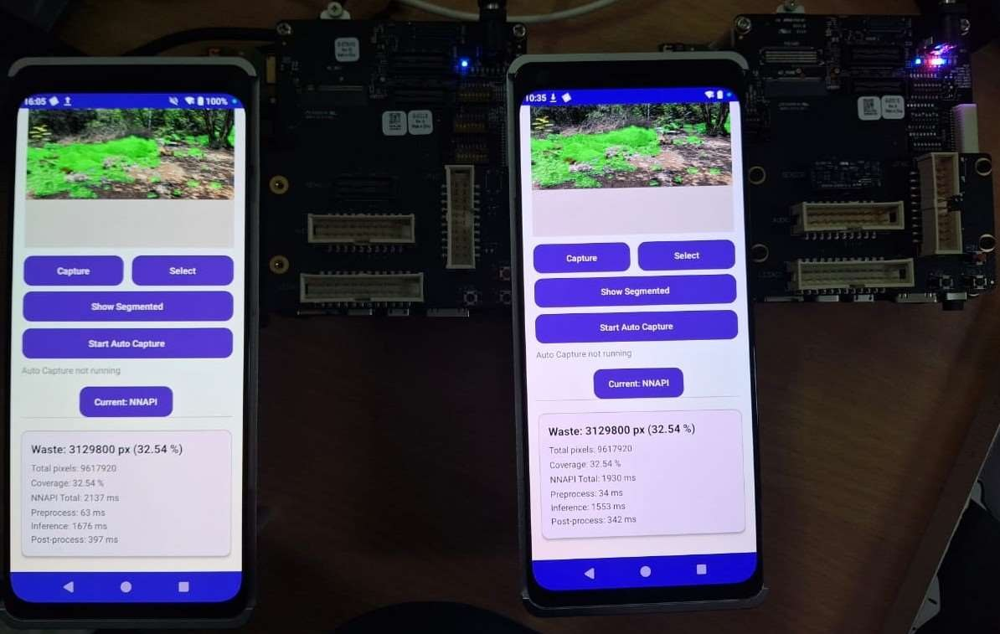
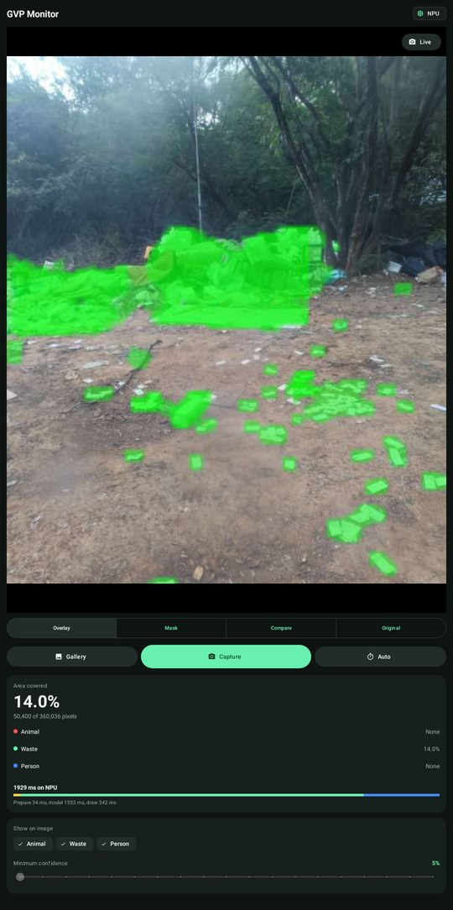

# Garbage Vulnerability Point Monitoring

Finds and measures garbage in camera images, on the device, in real time. It segments
each image into waste, people and animals, and reports how much of the scene is covered.
A garbage vulnerability point is a spot where people keep dumping waste, and the goal is
to monitor those spots automatically instead of inspecting them by hand.

Team project for the Embedded Systems Workshop at IIIT Hyderabad (Monsoon 2025), built
with Krithik Kambhampati, Phanindra Gollapali and Krishna Kaundinya P, and run on a
Qualcomm QIDK board.

## What is in this repo

| Folder | What it is |
|---|---|
| `android/` | The app that runs the model on the device |
| `model-comparison/` | Desktop tool that runs one image through every model |
| `raspberry-pi/` | Flask page that runs the model on a Raspberry Pi |
| `serial-monitor/` | Desktop tool that plots temperature and humidity from a serial port |
| `models/` | Trained PyTorch weights |
| `docs/` | Report, presentation and demo video |

## Results

Five models were trained on about 1,700 labelled images: CCTV footage from two dumping
sites, photos from around campus, and images collected online.

| Model | Mean IoU | F1 score |
|---|---|---|
| YOLOv11 | 0.75 | 0.69 |
| YOLOv8 | 0.72 | 0.69 |
| FCN ResNet50 | 0.61 | 0.66 |
| DDRNet23-Slim | 0.50 | 0.66 |
| U-Net | 0.49 | 0.60 |

YOLOv11 was deployed. On the QIDK, the NPU was about 100 ms faster than the CPU.
The full method is in `docs/report.pdf`.

## The Android app



The first version of the app running on two QIDK kits.

Take a photo or pick one from the gallery, and the model runs on the device.

- Runs on the GPU, the NPU (through NNAPI) or the CPU, and can be switched at any time
- Four views of a result: overlay, mask, original, and a compare view with a handle
  you drag across the image
- Change the minimum confidence or hide a class and the image updates at once, without
  running the model again
- Shows the area covered, a breakdown by class, object counts and where the time went
- Auto capture takes a photo at a set interval, for leaving the device at a site
- Saves every result on the device, and uploads to Firebase if it is set up



The redesigned screen, drawn from the app's layout. The image is real model output, the
timings are from the QIDK, and the coverage figures are sample values.

### How it works

```
camera or gallery
      |
      v
letterbox to 640x640 --> YOLO11 (TFLite) --> decode + NMS --> draw masks --> stats
                                                  ^
                                                  |
                              confidence and class filters redraw from here
```

### Code layout

Everything is under `android/app/src/main/java/com/example/esw/`.

| Package | Job |
|---|---|
| `segmentation` | The pipeline. `SegmentationEngine` runs it, `InterpreterPool` manages the processors, `YoloDecoder` and `Letterbox` hold the maths, `MaskRenderer` draws, and `SegmentationWorker` keeps it all on one background thread |
| `camera` | Preview and taking photos |
| `capture` | The auto capture timer |
| `storage` | Device storage, gallery export and Firebase upload |
| `ui` | The compare view and the results card |
| `util` | Loading images the right way up |

`MainActivity` only connects these together.

### Build

You need Android Studio or the Android SDK with platform 34, and JDK 17. Open `android/`
in Android Studio, or:

```
cd android
./gradlew assembleDebug
./gradlew testDebugUnitTest
```

The app targets 64-bit ARM devices running Android 9 or later. To also build for an
x86_64 emulator, add `-Pemulator`.

### Firebase (optional)

The app works without it and just keeps results on the device. To turn it on, create a
Firebase project with an Android app named `com.example.esw`, put its
`google-services.json` in `android/app/`, and add your database URL to
`android/local.properties`:

```
firebase.databaseUrl=https://your-project-default-rtdb.firebasedatabase.app
```

### Stored data

On the device, results go to `Android/data/com.example.esw/files/segmentation_captures/`:
one `seg_<timestamp>.jpg` per image and a `captures.csv` with a row for each. Auto capture
also saves to `Pictures/ESWSeg` on Android 10 and later.

## Desktop and Raspberry Pi tools

```
pip install -r model-comparison/requirements.txt
python model-comparison/run_all_models_gui.py
```

Only YOLOv8, YOLOv11 and DDRNet23 weights are in `models/`. The FCN and U-Net files were
too large to include, so those tabs stay empty.

```
pip install flask ultralytics opencv-python numpy
python raspberry-pi/raspi.py        # then open port 5000
```

```
pip install pyserial matplotlib
python serial-monitor/GUI.py
```
